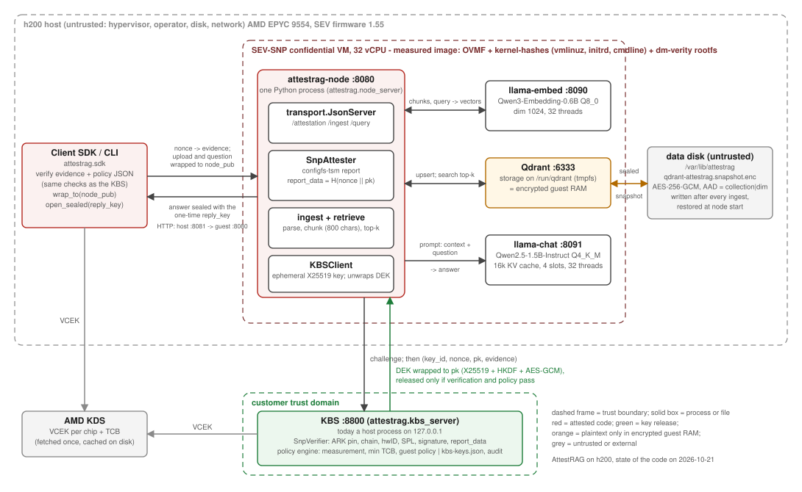
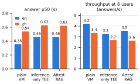

# AttestRAG: End-to-End Attested Retrieval-Augmented Generation across CPU and GPU TEEs

*Draft v0.3, 2026-10-28. Wei Wang. Status markers: **[done]** = implemented and measured on hardware; **[design]** = designed, not implemented; **[TODO]** = open item for the next draft.*

## Abstract

Enterprises hand contracts, medical records and source code to retrieval-augmented generation (RAG) services, yet every deployed "confidential inference" offering protects only the model call: documents are parsed, embedded, indexed and retrieved in the clear on the provider's host, and embeddings are not a safe intermediate form, since inversion attacks recover the text behind them. We present AttestRAG, a RAG system in which the whole pipeline, from parsing to generation, runs inside hardware-isolated confidential VMs, and in which a client can verify the entire chain before it uploads a single byte. AttestRAG binds the CPU TEE report, the GPU attestation and the measurement of every pipeline component into one composite statement; releases the keys that protect the persisted vector index only after a small, pure policy function accepts that statement; and seals every answer with a one-time key that only the attested node can learn, so that neither the host nor the network can forge or swap a reply. We built AttestRAG on AMD SEV-SNP with a reproducible, measured boot chain (firmware, kernel, initrd, command line and a dm-verity root filesystem under one launch measurement), attached an NVIDIA H200 in confidential-computing mode to the same VM, ran the same code inside an Intel TDX VM in Google Cloud, and evaluated it end to end on the RGB benchmark. Attestation is not the cost: establishing a verified session takes 10–30 ms with the CPU report alone and about 65 ms with the GPU transcript as well, far below a single answer. Retrieval inside the TEE loses nothing (hit@4 = 1.0 on both languages), and a judge pass that shares the answer prompt's cache refuses 85 % of the questions the corpus cannot answer at no latency cost. CPU-bound generation sets a latency floor of 1.4 s per English answer and 3.2 s per Chinese answer and collapses under concurrency; the same pipeline with the confidential GPU answers in 0.17 s and 0.28 s and serves 8 users at 7 answers per second, 25x the CPU throughput, with the GPU's firmware measurements pinned by the same policy. Against the identical pipeline in an ordinary VM with the GPU in normal mode, confidential computing costs 16–30 % of the median answer latency at one user and 16–21 % of throughput at eight, more than the model call alone is reported to cost, because at batch 1 the encrypted driver channel's per-submission latency, not compute, dominates the decode; the share falls as the model grows (30 % at 1.5B, 11–15 % at 7B–14B) because the cost is per kernel launch, not per FLOP; and an inference-only TEE deployment pays the same, so protecting the whole pipeline costs nothing over protecting the model call. The key broker signs every release and records the version of the sealed index, so the host can neither hand the node a key of its own nor roll the index back to a snapshot the tenant has retracted. The verifiers, policy engine and key-release protocol are 2.9 k lines of Python with no dependency beyond a cryptography library, small enough to analyse as a whole: a Tamarin model proves possession, freshness, session binding, release authenticity and answer authenticity, and it exposed two gaps on the way, a colluding operator's own confidential GPU standing in for the attached one and the host substituting the index key in an unsigned release, whose fixes the system now runs; and the policy function is an executable Lean specification whose compiled binary agrees with the engine on every tested input.

## 1 Introduction

RAG has become the default way to put private corpora in front of a large language model. The corpus is parsed into chunks, each chunk is embedded into a vector, the vectors are indexed, and at query time the nearest chunks are retrieved and pasted into the model prompt. Every one of these stages sees the customer's data in plaintext, and every one of them typically runs on infrastructure the customer does not control.

The industry's answer has been confidential inference: run the model inside a trusted execution environment (TEE), attest it, and call it over an encrypted channel. This protects exactly one stage. The parser, the embedding model, the vector database and the retriever remain outside the enclave, on the provider's host, where the host operating system, the hypervisor and the operator can read them. Nor is the vector representation a form of protection: few-shot embedding-inversion attacks such as ALGEN reconstruct the original text from a handful of vectors [15]. Cryptographic RAG proposals go the other way: RemoteRAG [13] hides the user's query behind differential-privacy noise and partially homomorphic distance computation, and SAG [14] encrypts chunks and vectors before they are stored, with a formal proof. Neither protects the generation step, where the retrieved plaintext meets the model, and both pay for the cryptography on every query.

Two things make a different design possible now. First, CPU TEEs that isolate a whole virtual machine (AMD SEV-SNP, Intel TDX) are generally available, and a recent evaluation measured LLM inference under TDX at under 10 % overhead, H100 confidential mode at 4–8 %, and a complete RAG pipeline (Elasticsearch, BM25, SBERT) inside TDX at 6–7 % [1]. Second, NVIDIA's Hopper and Blackwell GPUs offer a confidential-computing mode with their own attestation. What is missing is a system that puts the complete pipeline inside these TEEs and, more importantly, lets a client verify the complete pipeline as one object. The gap is not academic: the TEE.fail authors observed that NVIDIA does not bind an H100's attestation to the identity of the VM it serves, so an attacker can forward the GPU report of another machine [7].

This paper presents AttestRAG, a RAG system with the following properties.

- **Everything inside.** Parsing, embedding, the vector index, retrieval and generation run in confidential VMs. The vector database keeps its storage on a tmpfs inside encrypted guest memory; the only thing that reaches the host disk is an authenticated-encrypted snapshot.
- **One composite proof.** The CPU report carries, in its `report_data`, a hash of a session nonce and of an ephemeral public key generated inside the TEE; every GPU report of the session carries a hash of that CPU `report_data`. The launch measurement covers firmware, kernel, initrd, command line and, through a dm-verity root hash on the command line, every byte of the root filesystem, including the models and the vector database binary.
- **Keys only after proof.** A key broker service (KBS) outside the provider's trust domain releases the index key wrapped to the TEE's ephemeral key only after cryptographic verification of the composite evidence and after a policy decision that includes a measurement allow-list, a component-wise minimum TCB and the guest-policy bits of the VM. The release is signed by a KBS identity pinned in the measured image and carries the last committed version of the sealed index, so a host between node and KBS can neither substitute the key nor roll the index back.
- **Client-side verifiability.** The client SDK runs the same verifier and the same policy as the KBS, before it uploads anything. Questions are encrypted to the attested node key and carry a one-time reply key, and the answer is sealed with that key, so an answer the client accepts can only have been produced by the node that could read the question.

We implemented AttestRAG (Section 7), deployed it on a self-hosted SEV-SNP machine (2x AMD EPYC 9554, 4x H200 NVL) and ran it unchanged inside an Intel TDX VM in Google Cloud, with a reproducible image build whose measurement we verify offline. Section 8 reports the first end-to-end measurements on the RGB benchmark [18]. The GPU stage is implemented and measured on one H200 in confidential mode. The release protocol is modelled in Tamarin and the policy function is an executable Lean specification checked against the engine (Section 6). The Intel TDX verifier is implemented and verified against a quote from a Google Cloud C3 instance, inside which the whole flow also ran (Section 8.7). The paper marks what is designed but not built explicitly, and Appendix A lists the status of every claim.

**Contributions.**

1. A threat model and design for a RAG system in which no pipeline stage runs outside a TEE and the cloud operator and the service provider are both untrusted (Sections 4–5). **[done]**.
2. A composite attestation protocol that binds the CPU report, the GPU reports and the pipeline measurement into one verifiable statement, closing the GPU-report-forwarding gap (Section 5.2). **[done]**: the CPU half, the binding rule and the NVIDIA verifier, exercised against a real H200 transcript.
3. Post-attestation key release with a measurement allow-list, component-wise minimum TCB and guest-policy checks, and an index that is sealed per tenant, versioned against rollback and never present in plaintext on the host, with every release signed by the KBS so that the host cannot substitute the key (Sections 5.3–5.4). **[done]**.
4. A key-release protocol and policy designed for formal analysis: the protocol properties that matter (a key reaches only the TEE that proved possession in the same session; no replay; no cross-session GPU evidence) are stated for a symbolic protocol model, and the policy function is small, total and pure so that its executable specification can be the engine that actually runs (Section 6). **[done]**: the Tamarin model (eleven properties; two were refuted with concrete attacks, the GPU substitution and the key substitution, whose fixes are now deployed, after which all eleven hold, and the refuted models are kept and re-checked in continuous integration) and the Lean specification with twelve theorems and a differential test against the engine.
5. An open-source implementation and an end-to-end evaluation on real SEV-SNP hardware with a confidential H200 and on an Intel TDX VM in Google Cloud, including the attestation and key-release costs, retrieval and answer quality inside the TEE, and the concurrency behaviour of CPU-only against confidential-GPU inference (Sections 7–8). **[done]**.

## 2 Background

**VM-level TEEs.** AMD SEV-SNP and Intel TDX isolate an entire guest VM from the hypervisor: guest memory is encrypted with a per-VM key, integrity is protected (reverse map table on SNP, TD-owner bits on TDX), and the platform security processor signs an attestation report on request. An SNP report (version 5 on current firmware) contains the launch measurement, a 64-byte `report_data` field chosen by the guest, the guest policy bits (debug, migration agent, SMT, …), the current and reported TCB (bootloader, TEE, SNP firmware and microcode security version numbers), the chip identifier and a signature by the chip's VCEK, whose certificate chains to AMD's ASK and ARK. The launch measurement is computed over the initial memory image: with OVMF and the `kernel-hashes` feature it covers the firmware, the kernel, the initrd and the kernel command line [20].

**GPU confidential computing.** NVIDIA Hopper and Blackwell GPUs can run in a confidential mode in which a single GPU is passed through to a confidential VM, the PCIe link is protected by an SPDM session, device memory is encrypted and the GPU produces an attestation report over its firmware measurements, verifiable against NVIDIA's attestation service [21]. A reverse-engineering study of this mode found that over a thousand BAR0 register fields remain host-readable and that RPC metadata is in plaintext with timing side channels [12]. The report does not by itself say which VM the GPU is attached to; binding it to the CPU report is the system's job (Section 5.2).

**RAG pipeline and what each stage exposes.** Ingest parses documents into chunks (plaintext documents). Embedding turns chunks into vectors (plaintext chunks in, invertible vectors out). The vector index stores vectors and the chunk text as payload (both). Retrieval embeds the query and runs nearest-neighbour search (the query, the access pattern over the index). Generation puts the query and the retrieved chunks into one prompt (everything). A design that protects only generation therefore still leaks the corpus, the index and the queries.

**Remote attestation and key brokers.** The IETF RATS architecture [19] separates the attester, the verifier and the relying party. In confidential-container deployments the relying party is a key broker service (Trustee KBS in Confidential Containers [22]) that releases secrets only to attested workloads. AttestRAG follows this structure with its own small reference KBS, so that the complete release path can be read and, later, formalized.

## 3 Motivation and problem analysis

**Where inference-only TEEs leak.** Consider the common deployment: a vector database and an embedding service on ordinary hosts, and a model served from a confidential VM behind an attested TLS endpoint. The host of the vector database sees every chunk in plaintext as payload and every query as a vector and as text (the embedding service receives the raw query). The embedding host sees every document. Only the prompt-to-answer leg is protected, and that leg contains nothing the earlier legs have not already exposed. Encrypting the index at rest with a key held by the database host changes nothing, since the host holds the key.

**GPU report forwarding.** A GPU attestation report proves that *some* GPU with the stated firmware is in confidential mode. If the relying party accepts it alongside a CPU report without a cryptographic link between the two, an operator can run the model on an ordinary GPU and present the report of a confidential GPU elsewhere. This is exactly the gap TEE.fail reported for H100 [7]. The verifier rejects a real H200 transcript replayed under another session's `report_data` (Section 8.8); **[TODO]**: reproduce the forwarding with a second confidential GPU on another machine.

**Why not cryptographic RAG.** Differentially private and homomorphic retrieval [13] protects the query against the index host, and encrypted storage [14] protects the index at rest, but both still deliver plaintext chunks to a generation step that must see them; the generator is then the weak point, and the per-query cryptographic cost grows with the index. A TEE design pays a near-constant overhead instead and protects the generator too.

## 4 Threat model and security goals

**Assets.** Customer documents, chunks, embeddings, the vector index, queries, answers, and the data-encryption key (DEK) that seals the index.

**Trusted.** The CPU TEE hardware and firmware at or above the minimum TCB named in the policy (the AMD secure processor and SEV firmware; the TDX module once supported); the GPU confidential-computing firmware when a GPU is used; the measured AttestRAG VM image; the KBS, operated by the customer or a party the customer trusts; and the client SDK.

**Untrusted.** The cloud provider's host OS, hypervisor and operators; storage and the network; other tenants; and the AttestRAG operator when it is not the customer. The adversary can read, modify and replay anything on disk or on the network; boot a modified image; enable debug; run on an outdated, vulnerable TCB; and replay old evidence or splice evidence from a different VM, session or GPU.

**Goals.** (G1) Confidentiality of documents, vectors, queries and answers against everything untrusted. (G2) Integrity of retrieval results and answers: a client accepts an answer only if it was produced by the attested node over the question the client sent. (G3) Client-side verifiability: a client can establish G1 and G2 before uploading, with no trust in the provider.

**Out of scope.** Physical attacks on memory, such as the DDR5 interposer of TEE.fail [7] and the sub-$50 DDR4 interposer of Battering RAM [8], are excluded by the hardware vendors' threat model and by ours; firmware attacks on the AMD secure processor [9] and the SEV-SNP memory-consistency attacks of [10, 11] are the reason the policy carries a minimum TCB; microarchitectural side channels and the access pattern of nearest-neighbour search over the index are only partly mitigated and are discussed in Section 9; availability is not a goal. What the model *says* is not a security property: documents can carry prompt injections and a small model will follow them; AttestRAG grounds answers in retrieved chunks and citations but does not make the model honest.

## 5 System design

### 5.1 Architecture

```
  client SDK                 confidential VM (SEV-SNP [done] / TDX [done])
  1 verify composite         +---------------------------------------------------+
    evidence + policy  ----> | ingest/parse -> embed -> encrypted vector index    |
  2 upload (encrypted        |   -> retrieve/filter -> generate (llama.cpp/CUDA) |
    to node key)             |          | SPDM-protected PCIe, bounce buffers    |
  3 sealed answer <--------  |   H200 in confidential-computing mode [done]      |
         ^                   +---------------------------------------------------+
         |                           | prove (SNP report + GPU transcript), get key
         +------ verify ------ KBS + policy engine (customer's trust domain)
```

*Figure 1. One composite proof covers the whole pipeline: the SNP report of the VM and the attestation transcript of the GPU attached to it. The node proves itself to the KBS before it receives any key; the client verifies the same composite evidence before it uploads.*

The CPU confidential VM runs the ingest parser, the embedding model, the vector database (Qdrant) with its storage on a tmpfs inside guest memory, the retriever and the generator (a small instruction-tuned model served by llama.cpp, on the GPU when one is attached and on the CPU otherwise, from the same measured binaries). A GPU in confidential-computing mode is passed through to this VM rather than to a VM of its own: the PCIe link carries an SPDM session between the guest driver and the GPU, device memory is encrypted, and DMA goes through bounce buffers in guest memory. Because the GPU's own report does not say which VM it serves (Section 3), keeping the GPU inside the attested VM puts the driver that owns the SPDM session into the measured image and makes the GPU report part of the VM's session rather than a second party's. All of these are files in a read-only root filesystem whose dm-verity root hash is part of the launch measurement (Section 5.5), so replacing the embedding model, the vector database binary or the node's Python code changes the measurement and the KBS refuses the key. The node exposes three operations over JSON/HTTP: `attestation(nonce)`, `ingest(doc_id, wrapped_document)` and `query(wrapped_question)`; a query passes a relevance gate (Section 8.5) before the generator is asked for an answer.

### 5.2 Composite attestation

Every session starts with a 32-byte nonce from the verifier (the KBS, or the client). The node generates an ephemeral X25519 key pair inside the TEE and asks the platform for a report over

```
cpu_report_data = SHA-384("attestrag-rd-v2" ‖ nonce ‖ tee_pubkey ‖ gpu_id_1 ‖ … ‖ gpu_id_n)
gpu_report_data = SHA-384("attestrag-gpu-bind-v1" ‖ cpu_report_data)
```

with length-prefixed concatenation, so that no choice of a shorter nonce and a longer key can collide with another pair. `report_data` is the 64-byte field of the report that the guest chooses (offset 0x50 of an SNP report; a SHA-384 digest fills 48 bytes); the platform signs it together with the measurement and the TCB, so whatever is written there is bound to this chip and this launch.

The CPU rule binds two things. The *nonce* is a 32-byte random value from the verifier, single-use and expiring after 60 s: a report whose `report_data` matches it was produced in this session and cannot be a replay. This matters because SNP reports carry no timestamp; freshness rests entirely on the nonce. The *public key* is generated inside the TEE for this session and its private half never leaves it: the KBS wraps the DEK to that key, so a man-in-the-middle who relays a genuine report cannot open the key it obtains, and one who substitutes its own key breaks the hash and with it the signature. Together the rule states one fact, proved once: *this* TEE, in *this* session, holds the private key.

The GPU rule hangs every GPU report of the session off the CPU report: a GPU report carries not an independent nonce but the hash of the CPU `report_data`. The composite verifier therefore verifies the CPU evidence first, derives the expected GPU `report_data` from it, and only then verifies each GPU evidence. A GPU report is valid for exactly one CPU report, hence one session. This is the check that closes the forwarding gap of Section 3: a confidential GPU's report taken from another machine or another session fails the `report_data` comparison, whatever its own signature says. The two rules yield one statement for the policy engine: *this CPU TEE (measurement M, TCB T) holds sk in this session, and these GPUs attested for it in the same session*; the policy never judges a GPU on its own.

The identities $gpu\_id_i$ are what the TEE's own driver reports for the GPUs it talks to, for NVIDIA the SHA-384 of the GPU's attestation-key certificate, sorted; the verifier derives the same values from the certificates inside the GPU evidence and recomputes `report_data` before it checks the CPU report. This third rule is what makes the session commit to *which* GPU attested: the GPU rule alone establishes freshness, and Section 6 shows with a Tamarin counterexample that without the identity an operator could substitute the report of another confidential GPU it owns. What the binding still does not prove is that the SPDM link the driver holds terminates at that GPU's silicon rather than at an emulation; that rests on the measured driver and on NVIDIA's device certificate. **[done]**: the rule, the composite verifier and the NVIDIA verifier. The latter parses the SPDM GET_MEASUREMENTS transcript that the driver returns through NVML (the 37-byte request followed by the signed MEASUREMENTS response), chains the GPU's attestation-key certificate through NVIDIA's provisioning and identity certificates to the pinned NVIDIA Device Identity CA, verifies the ECDSA P-384 signature over request and response, compares the *request* nonce with `gpu_report_data` (the response nonce is chosen by the GPU, as SPDM specifies, so freshness comes from the signed request half of the transcript), checks the firmware identifier in the certificate's DICE extension against the one the report carries, and reduces the 64 DMTF measurement blocks to one SHA-384 digest that the policy pins. A transcript captured from the H200 inside the confidential VM is a golden test. Optionally the verifier also consults NVIDIA's services, as NVIDIA's own verifier does: it fetches the reference manifests for the driver and the VBIOS (SWID tags whose XML signature chains to NVIDIA's CoRIM signing root), compares every active manifest entry with the report's measurement block of the same position, and asks NVIDIA's OCSP responder about every CA certificate of the attestation-key and manifest chains; the policy can require either (`require_gpu_rim`, `require_gpu_ocsp`). **[done]**; on our card the driver manifest for 580.178.04 matches all 22 active entries, while NVIDIA has published no VBIOS manifest for this H200 NVL firmware, so the deployed policy requires revocation checks and records the manifests, and the pinned composite digest covers the VBIOS blocks.

**What the SNP verifier checks.** Parse the version-5 report; reject VLEK-signed reports (not yet supported) and unknown signature algorithms; derive the product (Milan, Genoa, Turin) from the CPUID family and model in the report and refuse a mismatch with the configured product; fetch AMD's ARK and ASK for that product from the bundled copies and compare the ARK against a pinned public key; fetch the VCEK for the chip identifier and reported TCB from AMD's key distribution service, caching it on disk; verify the chain ARK → ASK → VCEK and the certificates' validity window; check that the VCEK's hardware-identifier extension equals the report's `CHIP_ID` and that its SPL extensions equal the report's `REPORTED_TCB`; verify the ECDSA P-384 signature over the report; and compare `report_data` against the expected value. The verifier then emits claims: platform, measurement, decoded TCB components, debug flag, guest policy, launch TCB and signer identity.

### 5.3 Key hierarchy and release

The KBS holds one record per tenant, named by a key identifier: the index DEK, the last committed index version, and a client token. It also holds an Ed25519 identity key; its public half is written into the node's configuration file, which is part of the measured image, so the measurement fixes which KBS a node will take keys from. The release protocol is:

1. the node requests a challenge and receives a single-use nonce with a 60 s lifetime;
2. the node generates the ephemeral key pair, obtains the composite evidence over `cpu_report_data(nonce, pub, gpu_ids)`, the identities being those of the GPUs its own driver talks to, and sends `(key_id, nonce, pub, evidence)`;
3. the KBS consumes the nonce (even on failure), verifies the evidence, evaluates the policy, writes an audit record, and only on `allow` returns `(version, DEK, token)` wrapped to `pub` with X25519 ECDH, HKDF-SHA256 (salt = both public keys, info = a versioned label and the key identifier) and AES-256-GCM, together with its signature over the label, the key identifier, the nonce, `pub` and the wrapped blob;
4. the node checks the signature against the pinned identity, unwraps in TEE memory and opens the sealed index, refusing anything older than `version` (Section 5.4);
5. after each ingest the node seals the index as `version + 1` and commits that number with an HMAC under a key derived from the DEK; the KBS verifies the tag and only ever moves the version forward.

The signature in step 3 is not decoration. The wrap protects the DEK from everyone but the holder of the ephemeral private key, but anyone can wrap *something* to a public key: without the signature the host between node and KBS replaces the response with a DEK of its own, the node seals every snapshot under it, and the host reads the documents off its own disk. The protocol as deployed before step 17 had exactly this gap; the Tamarin model of Section 6 finds the trace (`release_authentic`, `doc_secrecy` falsified in the unsigned theory) and the client-side verification of the node does nothing against it, because the node *is* the measured image, doing what it was told. The commit tag in step 5 is the same idea in the other direction: a version can only be advanced by a party that was released the key.

**Tenants.** A node serves one or more tenants, one KBS record each, with separate DEKs, separate sealed indexes (one Qdrant collection per tenant) and separate client tokens. Every request names its tenant, is wrapped with that name in the key-derivation info, and carries an HMAC under the tenant's token over the encrypted payload; a request re-routed to another tenant's index fails the wrap, and a client without the token is refused before anything is decrypted. Isolation between tenants is therefore cryptographic for data at rest and for key release, and rests on the measured node code in memory: the same trust a single tenant already places in that code. Per-session keys for the client channel are the ephemeral wrap per request and the one-time reply key per question (Section 5.6). **[done]**

**Policy.** The verifier establishes that the evidence is genuine; the policy turns that into a decision that the machine is worth trusting. It is the customer's own statement, evaluated independently by the KBS and by the client with the same rules, that only a TEE running the named image, on firmware at or above a named version and without debug enabled, may receive a key. A policy is a plain record: allowed CPU platforms, a measurement allow-list, a component-wise minimum TCB (bootloader, TEE, SNP firmware, microcode), the allowed guest-policy values (for example `0x30000`, which forbids debug and the migration agent and fixes the ABI version), whether debug is allowed, a freshness window, and the same fields for GPUs. Evaluation is a total function from policy and claims to a decision with a list of reasons; `allow` holds if and only if the list is empty. The TCB comparison is component-wise and never lexicographic: a newer microcode does not compensate for an older SNP firmware.

### 5.4 Persisted index

The vector database runs with its storage directory on a tmpfs, so vectors and chunk text exist only in encrypted guest RAM. After each ingest the node asks the database for a collection snapshot, seals it with the DEK under AES-256-GCM with the format version, the collection name and the vector dimension as associated data, and writes it to an untrusted data disk provided by the host. At start the node unseals the snapshot in memory and restores the collection through the database's upload interface, so plaintext never touches a file. A host that edits, truncates or swaps the file gets an authentication failure and the node refuses to start. **[done]**. The snapshot is whole-collection, so sealing costs O(index) per ingest; incremental sealing or a dm-crypt volume keyed by the KBS is future work.

**Rollback.** Authenticated encryption cannot tell yesterday's validly sealed snapshot from today's. A host that keeps the old file and puts it back after a tenant deleted a document (a retracted contract, a corrected advisory) serves the deleted content through a node that passes every attestation check. Each sealed file therefore carries its version in a clear header that the AEAD authenticates, the KBS records the last version the node committed and hands it over with the key, and the node refuses to start on a snapshot that is older than that record or missing altogether; a file newer than the record (sealed, but the commit never reached the KBS) is accepted and re-committed. A legitimate loss of the index is an explicit operator action at the KBS. **[done]**. Permission-aware retrieval below the tenant level (filtering by the caller's rights inside one tenant's index) is **[design]**.

### 5.5 Measured image and boot chain

The guest image is built reproducibly: a golden qcow2 image is shrunk to a minimal ext4 root, a dm-verity hash tree is computed with a fixed salt, and two consecutive builds are byte-identical. The VM boots OVMF with `kernel-hashes` enabled, so the launch measurement signed by the platform covers the firmware, the kernel, the initrd and the command line; the command line carries `roothash=<dm-verity root hash>`, so every block of the root filesystem is transitively under the measurement. Guest writes go to a tmpfs overlay and are lost at reboot; persistent state exists only through the attested KBS and index path. The expected measurement is computed offline with `sev-snp-measure` [25] from the firmware, kernel, initrd, command line, vCPU count and vCPU model, and equals the value the platform signs. The policy JSON is never part of the image, since it would have to contain its own measurement; the verifier side supplies it.

### 5.6 Client SDK and answer authenticity

The client runs the same verifier and policy as the KBS. `connect()` draws a nonce, requests the node's evidence and its transport public key, verifies the evidence against `cpu_report_data(nonce, node_pub)`, evaluates the policy, and only then remembers `node_pub`; any call before a successful `connect()` is refused locally. Documents are wrapped to `node_pub` with the document identifier as context. A question is wrapped together with a freshly drawn one-time reply key; the node's answer, including the retrieved hits and citations, is sealed under that reply key with a fixed associated-data label. An adversary on the network or on the host can neither read the question nor produce an answer the client will accept, because learning the reply key requires the node's private transport key, which exists only inside the attested VM. An earlier design that returned answers in plaintext was forgeable on the network; this version fixes it.

## 6 Formal analysis of key release

Where formal methods earn their place here is the release protocol, not the policy function. The policy function is under a hundred lines of set membership and integer comparison; a proof that it satisfies its own rules would mostly restate it. None of the defects found while building the system were in it: the launch-TCB field read at the wrong offset, the certificate parser rejecting AMD's zero serial numbers, and an earlier answer path that a network adversary could forge all sat in the verifier, the parser and the protocol. The analysis is therefore split into two parts with different tools, and the paper states what neither covers.

**Protocol properties [done].** The release protocol of Section 5.3 together with the binding rules of Section 5.2 forms a small protocol between a TEE, a KBS, a client and a network adversary who controls the host. We modelled it in Tamarin (`formal/`, 230 lines including comments): the PSP and NVIDIA's root as unforgeable signers; the measured image as a TEE that generates its transport key inside, pins the KBS identity and has one attached GPU with its own certified attestation key; any other image as adversary-controlled, free to put anything into `report_data`; adversary-owned certified GPUs that sign any nonce; the KBS with single-use nonces, `rd = h(\text{nonce}, pk)`, the policy's two allowed measurements, a version record per key, and the key and version released as public-key encryption to $pk$ under the KBS signature; the node sealing uploaded documents to the untrusted disk under the key as a new version and committing that version with a MAC under the key; and the client's upload and question with a one-time reply key. The properties, all proved automatically (every lemma in seconds to minutes with Tamarin's automatic source lemmas):

- **Possession** (`dek_secrecy`, `release_only_to_good_prover`): a released key is never known to the adversary, and a release for nonce $n$ to $pk$ is preceded by the measured image attesting over exactly $n$ and $pk$; an adversary who relays genuine evidence obtains nothing it can open.
- **Freshness** (`no_replay`): one release per nonce; evidence replayed after its nonce was consumed is never accepted.
- **No cross-session GPU evidence** (`gpu_bound_to_session`): a GPU report accepted with a session was signed over that session's `report_data` after the nonce was issued; a report from another session is rejected whatever its own signature says.
- **Document secrecy and answer authenticity** (`doc_secrecy`, `answer_authentic`): a document the client uploads after verification is never known to the adversary, also once the node has sealed it to the host's disk, and an answer the client accepts was produced by the measured image holding the key, since the reply key travels only inside the question wrapped to the attested $pk$.
- **Release and version authenticity** (`release_authentic`, `version_authentic`, `commit_authentic`): the key the measured image holds was released to it by the KBS in a session it attested, the version it takes as the rollback floor is the one the KBS recorded, and the KBS only records a version the measured image sealed and committed.

Two properties we wanted did not hold at first, and Tamarin produced both attacks. The first is `gpu_is_the_attached_one`, that the GPU whose report is accepted is the one attached to the attesting VM. The trace is the residual gap Section 5.2 states informally, made concrete: `report_data` is public, so an operator who owns another certified confidential GPU asks it to sign this session's GPU nonce and swaps the GPU half of the evidence in transit. Freshness still holds, so this is not the cross-session forwarding of Section 3, but it lets a host hide a GPU with disallowed firmware behind one good GPU. Changing one line of the binding, $rd = H(\text{nonce} \,\|\, pk \,\|\, pk_{GPU})$ with $pk_{GPU}$ the attestation key the TEE's own driver talks to, makes all eight lemmas hold: a substituted GPU half no longer matches the CPU report. This is the binding of Section 5.2 as the system now runs it (`attestrag-rd-v2`); the model of the earlier binding is kept alongside with its attack trace, and a unit test replays the substitution against both bindings with mock GPUs.

The second came out of adding the version record and the persistence step to the model. With the release wrapped to $pk$ but not signed, which is what the system did until step 17, Tamarin refutes `release_authentic` in six steps and `doc_secrecy` in fifteen: the adversary wraps a key of its own to the node's $pk$, the node accepts it, seals the uploaded document under it, and the adversary opens the file. Nothing the client verifies can catch this, because the node is the measured image behaving exactly as measured; the key it was handed is what is wrong. The fix is the KBS signature over nonce, $pk$ and the wrapped blob, checked by the node against an identity pinned in the measured configuration, after which all eleven lemmas hold. The unsigned model is kept as `attestrag_release_unsigned.spthy` with its three falsified lemmas, and the continuous-integration job re-proves every lemma of all three theories and compares each verdict against the expected one, so the attack traces stay found and the proofs stay proofs.

The model abstracts the hardware signatures as unforgeable, the key wrap as public-key encryption, hashes, the KDF and the commit HMAC as a free hash, index versions as fresh names (who may introduce one is modelled, their order is not), drops the nonce TTL (single use is the property that matters) and treats the verifier as correct; it will not find a parsing bug, a wrong reference value in the policy, or a side channel.

**Executable policy specification [done].** The policy function, `evaluate(policy, claims, now)`, is total, pure and operates on frozen records of strings and integers, and it is the one piece that must agree exactly between the KBS and every client. We wrote it a second time in Lean 4 (`formal/lean`, 134 lines, core library only): the same structures, the same rules in the same order, the same reason strings byte for byte. Twelve theorems (94 lines) state what the engine is meant to guarantee: `allow` holds iff the reason list is empty; CPU debug mode without `allow_debug` denies; a measurement outside the allow-list denies; `require_gpu` without GPU claims denies; one TCB component below its minimum, or absent from the report, denies whatever the other components are (the component-wise rule, never lexicographic); and enlarging the measurement allow-list never turns an allow into a deny. The usual objection, that the verified model is not the code that runs, is met from both sides: the specification compiles to a native binary that reads a policy, claims and a time as JSON and prints the decision, and a differential test runs it against the Python engine on 500 random policy/claims pairs (every platform, allow-lists, TCB vectors with short and missing components, debug, freshness at every boundary, guest-policy strings in hex and decimal, the RIM and OCSP extras, zero to two GPUs) and on the published h200 policy against the verified claims of the composite golden fixture with six variations; every case agrees on `allow` and on the reasons. The two implementations differ only at the input: the specification takes whole seconds, expects the TCB minimums sorted by component (the loader sorts) and denies an unparsable guest-policy string where the engine raises. Replacing the Python engine by the compiled specification in the KBS is a one-line change we have not made; the test keeps them equal.


## 7 Implementation



AttestRAG is about 2,850 lines of Python 3.11 in ten modules (attest, policy, kbs_client, common, ingest, embed, index, retrieve, generate, sdk) plus 840 lines for the node, the two HTTP services and the demo, with 2,450 lines of tests (119 tests, including a real Genoa report and VCEK verified against AMD's pinned roots, a real H200 attestation transcript verified against NVIDIA's, a real TDX quote from a Google Cloud C3 instance verified against Intel's, plus a bound SNP+GPU pair as the composite golden case) and 1,000 lines of deployment shell. The NVIDIA attester is 30 lines over NVML; the verifier is 150 lines and needs nothing from NVIDIA's SDK. The TDX verifier is 560 lines including the Intel PCS client and needs nothing from Intel's DCAP libraries: quote parsing, the PCK chain to the pinned Intel SGX Root CA, the Quoting Enclave report and the quote signature, TCB info and QE identity as signed JSON, and the TCB-level, TDX-module and QE matching rules. The only runtime dependencies are `cryptography` and `numpy`; checking NVIDIA's reference manifests adds `signxml` for the XML signatures. The SNP attester uses the kernel's configfs-tsm interface and needs no vendor tool inside the guest; the verifier bundles AMD's root certificates and fetches VCEKs from AMD KDS with an on-disk cache. The HTTP transport is JSON over the standard library (no TLS yet: metadata such as document identifiers and sizes is visible on the wire). Generation and embedding use llama.cpp's server [23] with Qwen3-Embedding (0.6B Q8_0, 1024 dimensions, or 8B, 4096 dimensions) and Qwen2.5-Instruct in Q4_K_M (1.5B for the CPU-only configuration, 7B once the GPU is attached, 14B and the Qwen3-Next-80B mixture of experts in the last experiments of Section 8.5); every fetched model file is in the image, and which ones the servers load is part of the measurement; the vector database is Qdrant 1.19 [24] accessed over its REST API. All binaries and model weights are pinned by SHA-256 in the image build.

The self-hosted deployment runs QEMU 11.1 built from source (distribution packages lacked SEV-SNP guest support) with OVMF.amdsev from Ubuntu's 2025.11 build; the Ubuntu 24.04 firmware (2024.02) fails to boot under upstream QEMU SNP. The guest is a 32-vCPU, 16 GB SEV-SNP VM; the vCPU count is part of the measurement. The image is 12.4 GB with the two small generators (81 GB with all six models) and boots unattended into attest → key release → serve. An end-to-end script runs 52 checks against the live VM: SNP active, dm-verity root bound to the expected root hash, the platform-signed measurement equal to the offline value, key release allowed under the published policy and denied with a wrong measurement and with a minimum TCB above the platform's, the client refusing to upload to a node whose measurement is not in its policy, the sealed snapshot restoring the index after a restart, the node refusing a release from an impostor KBS and refusing a rolled-back or removed snapshot, and two tenants on one node with their tokens enforced (Section 8.8).

**Continuous integration and reproducibility.** Every push runs the unit and end-to-end tests on two Python versions, builds the Lean specification and runs its differential test, and proves every lemma of the three Tamarin theories on a runner each, comparing each verdict with an expected list, so that a lemma that stops being provable and an attack trace that stops being found both fail the build. The hardware fixtures (a Genoa report with its VCEK, the H200 transcript with its certificate chain, reference manifest and OCSP responses, the TDX quote with its PCS collateral) are checked in with the time at which they are to be verified, so the signature, chain and policy paths run on every commit without the hardware. The image build is reproducible: two builds of the same inputs are byte-identical and the launch measurement is computed offline with sev-snp-measure [25] and compared with the one the platform signs.

The GPU is one of the host's four H200 NVL, switched to confidential mode with NVIDIA's administration tool and passed to the VM with VFIO over iommufd (the legacy VFIO container caps DMA mappings at 65,535, too few for a guest whose memory flips between private and shared page by page). Four things stood between a working GPU and the first CUDA call, none of them in the attestation path: a 1 TB 64-bit MMIO window made the firmware spend over fifteen minutes in its page tables (512 GB, enough for the GPU's 256 GB BAR, boots in seconds); the GPU had to sit behind a PCIe root port with a link speed, since on the root bus the driver reports an unknown link rate and CUDA refuses to initialise although attestation works; the distribution's kernel-module package needs its module index rebuilt in the image; and CUDA stays disabled until the guest sets the GPU's ready state, which a unit now does before the servers start. Detaching the GPU from the host was the only step that touched the host's other workloads: every CUDA process opens every GPU's device node, so the driver cannot release one GPU until all of them restart.

Two implementation findings in the verifier are worth recording. The launch-TCB field sits at offset 0x1F0 of a version-5 report, not 0x1F8 as an earlier draft assumed; the real report caught it. And AMD's VCEK certificates carry serial number 0, which recent versions of the `cryptography` library deprecate; the verifier loads them explicitly so that a future hard rejection fails loudly in the golden test rather than silently in production.

## 8 Evaluation

The evaluation answers three questions: what attestation and key release cost; whether moving the whole pipeline into the TEE loses retrieval or answer quality; and where the time goes. All measurements are from the self-hosted machine (2x EPYC 9554 Genoa, SEV firmware 1.55, 32-vCPU SEV-SNP guest), through the attested client path: the CPU-only configuration on 2026-10-20 (Sections 8.3–8.4) and the same image with the confidential H200 attached on 2026-10-23 (Section 8.5). Section 8.6 compares against the identical pipeline in an ordinary VM and against an inference-only TEE deployment. **[TODO]**: larger indexes and a second CPU platform (TDX) are not yet measured.

### 8.1 Benchmark and method

We use RGB [18], a bilingual benchmark for RAG with 300 English and 300 Chinese news questions, each with positive passages that contain the answer, negative passages on the same topic without the answer, and answer aliases. For 100 sampled questions per language we ingest one document per question holding its positive and negative passages shuffled (median 24 passages); for a held-out 20 % the positives are omitted, so the corpus contains on-topic noise but no answer. Each question is asked once with k = 4. Retrieval is scored as hit@4 (a retrieved chunk shares a 120-character window with a positive passage), answers with RGB's alias match, and rejection by a phrase list in both languages. A concurrency sweep then runs N clients, each with its own attested session, over 16 questions never asked before, since llama.cpp caches prompt prefixes and repeated questions would measure the cache.

### 8.2 Attestation and key release

Establishing a verified session, which is an SNP report through configfs-tsm, the certificate-chain and signature checks with the cached VCEK, and the policy evaluation, takes 10–30 ms on the client (median 12 ms across 64 sessions in the sweep). The first contact with a chip and TCB adds one fetch from AMD KDS, after which the VCEK is cached. Key release at node start is one such round trip plus the unsealing of the snapshot. With the GPU attached the session also carries the SPDM transcript and its five-certificate chain; verifying them adds about 35 ms (65 ms per session in the GPU sweeps). Per-user attestation is therefore free compared with one answer on the CPU and about a third of one on the GPU.

The signed release, the version commit after an ingest and the tenant tag on every request (Section 5.3) cost nothing a client can see: the same sweep on the step-17 image gives the same single-user latency as before them (p50 0.44 s against 0.41 s English, 0.61 s against 0.60 s Chinese; `docs/benchmarks.md`), since the signature is per session, the commit per ingest, and the tag one HMAC over a ciphertext the node has to read anyway.

### 8.3 Retrieval and answer quality inside the TEE

| | Chinese | English |
|---|---|---|
| corpus (100 documents) | 814 chunks | 3,762 chunks |
| hit@4 | 1.00 | 1.00 |
| positive chunks among the 4 (mean) | 3.2 | 3.1 |
| answer accuracy (RGB alias match) | 0.94 | 0.96 |
| false rejection on answerable questions | 0.00 | 0.00 |
| held out: rejection ("context insufficient") | 0.05 | 0.05 |

Retrieval through the encrypted index and the in-TEE vector database loses nothing: a positive passage is among the four retrieved chunks for every question, in a corpus where two thirds of the passages are on-topic noise. The remaining answer errors are the 1.5B generator picking the wrong fact out of a correct context. The weak point is negative rejection: when the answer is absent from the corpus the model refuses only 5 % of the time and otherwise answers from pretraining or fabricates. This is the behaviour the RGB authors report even for ChatGPT; for AttestRAG it means that the generator, not the TEE, bounds answer trustworthiness, and that a production node needs a larger model or a relevance gate that refuses when no chunk passes a similarity threshold. Rejection rate should be reported as a security-relevant metric alongside accuracy.

### 8.4 Latency and throughput

| single user, client side | Chinese | English |
|---|---|---|
| ingest, per document (median 24 passages), p50 / p90 | 4.5 s / 5.9 s | 6.1 s / 8.6 s |
| ingest throughput | 1.8 chunks/s | 6.2 chunks/s |
| answer (embed + search + generate), p50 / p90 | 3.2 s / 3.7 s | 1.4 s / 1.7 s |

Chinese is slower because the same 800-character chunk is about three times as many tokens: the prompt is around 2,000 tokens against 700 for English, and CPU prompt processing runs at about 700 tokens per second on 32 vCPUs. Ingest time is embedding plus the whole-collection sealed snapshot after every document, so it grows with the collection. For calibration, the first configuration of the same VM (8 vCPUs, 2 embedding threads, 6 generation threads) ingested 0.31 chunks/s and answered a Chinese question in 10.3 s; the vCPU count and the thread counts are part of the measured image, so the change was a rebuild with a new expected measurement.

| users | English q/s | English p50 / p90 | Chinese q/s | Chinese p50 / p90 | errors |
|---|---|---|---|---|---|
| 1 | 0.60 | 1.4 s / 2.7 s | 0.36 | 3.1 s / 3.5 s | 0 |
| 2 | 0.21 | 8.9 s / 16.4 s | 0.18 | 12.5 s / 16.7 s | 0 |
| 4 | 0.23 | 17.4 s / 25.6 s | 0.17 | 17.6 s / 35.8 s | 0 |
| 8 | 0.29 | 26.5 s / 39.5 s | 0.24 | 34.3 s / 47.6 s | 0 |

Throughput drops three-fold as soon as two users overlap and does not recover: the inference server runs four slots on a unified KV cache and interleaves the prompts, while the embedding server and the generation server, 32 threads each, run at the same time on 32 vCPUs and oversubscribe them. (With the inference server's default 4,096-token cache the same sweep failed outright for two or more users with KV-cache allocation errors; a 16k cache removed the errors but not the slowdown.) None of this is attestation cost; it is CPU inference, and it is the quantitative motivation for the GPU stage: prompt processing at 700 tokens per second is the whole budget, and a GPU in confidential mode does the same work in milliseconds, as the next section measures.

### 8.5 The confidential GPU configuration

The same image, corpus and questions with GPU3 of the host passed through in confidential-computing mode and both llama.cpp servers on the CUDA build with every layer offloaded. The policy now requires GPU evidence and pins the composite digest of the GPU's 64 firmware measurements, so every session in this table verified an H200 transcript as well as an SNP report.

| | Chinese | English |
|---|---|---|
| verified session (SNP report + GPU transcript + policy) | 0.07 s | 0.06 s |
| answer accuracy (RGB alias match) | 0.95 | 0.975 |
| hit@4 / false rejection / held-out rejection | 1.00 / 0.00 / 0.05 | 1.00 / 0.00 / 0.05 |
| answer, single user, p50 / p90 | 0.28 s / 0.34 s | 0.17 s / 0.21 s |
| 2 users: q/s, p50 / p90 | 5.0, 0.37 s / 0.57 s | 1.7, 0.39 s / 6.9 s |
| 4 users: q/s, p50 / p90 | 3.7, 0.57 s / 2.1 s | 6.7, 0.58 s / 0.83 s |
| 8 users: q/s, p50 / p90 | 6.7, 1.07 s / 1.34 s | 7.1, 1.04 s / 1.29 s |

An answer is 8x (English) to 11x (Chinese) faster than on 32 vCPUs and eight users get 25x the CPU throughput (7.1 against 0.29 answers per second), because generation now runs at 330–390 tokens per second and prompt processing is no longer the budget; what remains per answer is retrieval plus a few hundred milliseconds of generation. The language gap shrinks from 2.3x to 1.6x since the longer Chinese prompts are cheap on the GPU. Quality is unchanged, the models being the same, and so is the negative-rejection weakness with the 1.5B model (the 7B model below changes that). The two p90 outliers (6.9 s at two users, 2.1 s at four) are single slow requests, not errors. The confidential-mode overhead of the GPU itself is not separated here: the same build on an unprotected H200 was not measured in this round, and the 4–8 % that [1] and [5] report for Hopper is below the noise of a 100-question sample. What the table does show is the cost of the composite proof: about 30 ms per session for the GPU half, against answers of 170–280 ms.

The spare device memory also pays for the generator the CPU could not afford. With Qwen2.5-7B-Instruct in place of the 1.5B model (same quantisation, 7.7 GB of device memory), negative rejection, the weak spot of Section 8.3, rises from 5 % to 35 % of the held-out questions in both languages and Chinese answer accuracy to 0.99, at 2.5x the single-user latency and half the 8-user throughput, both still an order of magnitude inside the CPU-only envelope. 35 % is not yet a safe gate; a relevance threshold or a verifier pass remains necessary, but it is now a filter on top of a model that does refuse, not a substitute for one. Going further up, to Qwen2.5-14B with the 8B version of the embedder (4096 dimensions, index rebuilt), does not buy what the first step bought: accuracy is flat, retrieval was already saturated so the larger embedder changes nothing, and rejection moves in opposite directions by language, up to 55 % in English and down to 20 % in Chinese, where the larger model answers more held-out questions from its own memory. The price is twice the latency and a third of the throughput. A mixture-of-experts generator, Qwen3-Next-80B with 3B active parameters, was the last attempt, in the hope of large-model quality at small-model latency: it is slower still (its hybrid linear-attention layers and expert routing run through young kernels in this llama.cpp build, and every token touches experts spread over 48 GB), its quality is no better, and it answers 40 % of the Chinese held-out questions correctly from its own memory, which is the opposite of what a retrieval gate wants. The rejection gate has to be explicit; model size is not the lever, and the 7B configuration is the one to deploy. We then built the gate. A threshold on the retrieval score does not work: RGB's held-out questions come with same-topic passages, so the best chunk scores 0.57–0.78 against 0.57–0.87 for answerable questions, and at 2 % false rejection the threshold refuses 5–10 %. A *judge* does: before the node asks the generator for an answer it asks it, with the same system prompt, context and question and one trailing instruction, whether the context explicitly states the fact the question asks for, YES or NO, and refuses on NO without generating. Because the judge prompt shares its prefix with the answer prompt, the inference server's prompt cache serves it, so it costs a few tokens of prefill rather than a second pass over the context. With the 7B model the judge refuses 85 % of the questions the corpus cannot answer, in both languages, at 3.75 % false rejection (3 of 80 answerable questions), with the same single-user latency as before and higher throughput under load, since refused questions skip generation (`Table~\ref{tab:gate}`{=latex}). The gate is part of the node's measured configuration.

| 7B + 0.6B, GPU | no gate | score gate (2 % false rej.) | judge gate |
|---|---|---|---|
| held-out rejection (zh / en) | 0.35 / 0.35 | 0.05 / 0.10 | 0.85 / 0.85 |
| false rejection (zh / en) | 0.00 / 0.025 | 0.013 / 0.013 | 0.038 / 0.038 |
| answered from memory (zh / en) | 0.00 / 0.10 | – | 0.00 / 0.05 |
| answer p50 (zh / en) | 0.62 / 0.46 s | – | 0.60 / 0.41 s |
| 8 users, answers/s (zh / en) | 2.6 / 3.6 | – | 3.2 / 4.2 |

| | 1.5B (zh / en) | 7B (zh / en) | 14B + 8B emb. (zh / en) | 80B-A3B + 8B emb. (zh / en) |
|---|---|---|---|---|
| answer accuracy | 0.95 / 0.975 | 0.99 / 0.975 | 0.99 / 0.975 | 0.94 / 0.99 |
| held out: rejection | 0.05 / 0.05 | 0.35 / 0.35 | 0.20 / 0.55 | 0.25 / 0.55 |
| held out: answered from memory | 0.00 / 0.05 | 0.00 / 0.10 | 0.05 / 0.10 | 0.40 / 0.20 |
| false rejection | 0.00 / 0.00 | 0.00 / 0.025 | 0.00 / 0.025 | 0.0125 / 0.0125 |
| answer p50 / p90 | 0.28 / 0.34 s, 0.17 / 0.21 s | 0.62 / 0.87 s, 0.46 / 0.63 s | 1.19 / 1.69 s, 0.81 / 1.12 s | 1.71 / 2.65 s, 1.32 / 1.63 s |
| 8 users: q/s | 6.7 / 7.1 | 2.6 / 3.6 | 0.95 / 1.8 | 0.66 / 1.0 |

### 8.6 What confidential computing costs

Two baselines, built from the same parts. The *unprotected* one is the same image booted as an ordinary QEMU VM (no SEV-SNP, standard firmware), the same GPU switched to normal mode and passed through the same way, and the node started with an explicitly insecure mock attester that the KBS and client are told to accept (`policies/insecure-baseline.json`; it proves nothing and exists for this comparison). The *inference-only TEE* one is the deployment of Section 3: the retrieval side (ingest, embedding, index, retrieval) in an ordinary VM, only generation inside the confidential VM with the confidential GPU; a second plain VM from the same image runs the node with the mock attester and calls the confidential VM's generation server over an encrypted channel (an ssh tunnel standing in for TLS to a confidential inference endpoint). Models, corpus, questions, sealing and transport are byte-identical across the three. `Table~\ref{tab:cost}`{=latex} gives the result with the 7B generator.

| | plain VM | inference-only TEE | AttestRAG |
|---|---|---|---|
| session setup | 0.017 s (mock) | 0.018 s (mock) | 0.062 s |
| en: answer p50 / p90 | 0.36 / 0.53 s | 0.46 / 0.64 s | 0.46 / 0.63 s |
| zh: answer p50 / p90 | 0.54 / 0.76 s | 0.63 / 0.88 s | 0.62 / 0.87 s |
| en: 8 users, answers/s | 4.21 | 3.28 | 3.55 |
| zh: 8 users, answers/s | 3.36 | 2.68 | 2.64 |
| accuracy, rejection | same | same | same |
| client can verify | nothing | the model call | the whole pipeline |



Two things follow (`Figure~\ref{fig:deployments}`{=latex}). The end-to-end price of confidential computing for this pipeline is 16–30 % of the median answer at one user and 16–21 % of throughput at eight against the plain VM, with quality unchanged. And protecting the whole pipeline costs the same as protecting the model call alone: the two confidential configurations are within noise of each other on every row, so the entire overhead is the confidential-GPU generation path, which the inference-only deployment pays too, while moving ingest, embedding, index and retrieval into the confidential VM adds nothing measurable. (The inference-only node embeds queries on its CPU, 35 ms against 9 ms on the confidential VM's GPU, and pays a hop to the remote generator; that is why it is not strictly faster.) What the customer buys with that nothing is the difference in the last row.

This is more than the 4–8 % that [1] and [5] report for the model call alone on Hopper at large batch, and the reason is visible in the workload: a batch-1 decode of a 7B model is a stream of small kernels, and in confidential mode every submission crosses the encrypted driver–GPU channel, so launch latency rather than compute sets the pace; the CVM adds bounce buffering for every virtio and GPU DMA. Batching amortises the first part, which is why the gap narrows from 30 % to 16 % as users are added. The 10 % end-to-end overhead target of our outline holds only under load, not for a single interactive user. The two halves of the overhead cannot be separated on this hardware: the NVIDIA driver refuses to attach a normal-mode GPU inside a confidential VM (`confComputeConstructEngine: capability is not enabled`), and a confidential-mode GPU in an ordinary VM is equally unsupported.


Does the price grow with the model? Four generators, each run twice on the same image with the chat model switched at run time, inside the confidential VM with the GPU in confidential mode and in the ordinary VM with the GPU in normal mode, say no: it shrinks (`Figure~\ref{fig:scaling}`{=latex}). `Table~\ref{tab:scale}`{=latex} pairs a token microbenchmark against the inference server itself (one 2.3k-token prompt, 128 generated tokens, prompt cache off) with the end-to-end RGB numbers. The confidential mode's cost is per submission, not per FLOP: every kernel launch and every transfer crosses the encrypted driver–GPU channel and the bounce buffers, so a model that does more work per launch amortises it. Prefill, a few large batched kernels, loses 6–14 %; decode, one short kernel sequence per token, loses 7–20 %, most for the smallest model. The 1.5B model pays 20–30 % of its latency and about 30 % of its eight-user throughput; the 7B and 14B pay 11–15 % and 16–20 %; the 80B mixture of experts sits between (12–17 %), since its expert routing adds small kernels per token. In absolute terms the overhead per answer grows slowly (40 ms at 1.5B, 60 ms at 7B, 200 ms at 80B) while the answer grows faster. For the models anyone would deploy for RAG, confidential computing is a 10–17 % tax at one user and 16–20 % under load, and it gets cheaper, not dearer, as the model gets bigger.

| generator | prefill tok/s (ratio) | decode tok/s (ratio) | answer p50 en / zh overhead | 8 users q/s en / zh overhead |
|---|---|---|---|---|
| 1.5B | 21.6k vs 25.2k (0.86) | 360 vs 453 (0.80) | +30 % / +28 % | −29 % / −32 % |
| 7B | 7.9k vs 8.8k (0.90) | 196 vs 220 (0.89) | +13 % / +15 % | −17 % / −18 % |
| 14B | 4.1k vs 4.3k (0.94) | 112 vs 120 (0.93) | +11 % / +15 % | −16 % / −20 % |
| 80B-A3B (MoE) | 3.3k vs 3.6k (0.91) | 153 vs 174 (0.88) | +17 % / +13 % | −27 % / −24 % |


### 8.7 The same stack on Intel TDX

A `c3-standard-4` Confidential VM with Intel TDX in Google Cloud (Sapphire Rapids, Ubuntu 24.04, kernel 7.0 with configfs-tsm) ran the unchanged code: the attester takes the quote through the same configfs-tsm interface as the SNP report (provider `tdx_guest`, the host's quote generation service behind the GetQuote hypercall), 8,000 bytes in quote format 4 [35] with the PCK chain inside. The verifier anchors the chain at the pinned Intel root, checks the Quoting Enclave report and the quote signature, and evaluates the platform against Intel PCS: FMSPC `00806f050000`, PCE SVN 13, TDX module 1 at SVN 15, QE SVN 6, TCB evaluation number 20, status `UpToDate` with no advisories. MRTD becomes the measurement, the four RTMRs and the SEAM measurements go into the claims. With that policy (`policies/gcp-c3-tdx.json`) the in-VM demo and the three-process flow (KBS, node with `--attester tdx`, client over HTTP, signed release, commit of version 1) complete, and a policy naming another measurement is denied with `measurement not in allow-list`; the quote is the golden case in `tests/fixtures/tdx/gcp-c3` with the PCS collateral cached beside it. Not covered: pinning the RTMRs (the kernel, initrd and command line of a cloud image change with every update; MRTD covers the firmware), PCK and root CRLs, and quote format 5. **[done]**

### 8.8 Security checks

The end-to-end suite exercises the negative paths on the live VM: a policy with a different measurement makes the client refuse to upload (exit 3) and makes the KBS deny the key with the reason `measurement not in allow-list`; a minimum SNP firmware version one above the platform's is denied with `tcb 'snp'=24 < required 25`; a guest-policy allow-list of `0x20000` denies the `0x30000` VM; flipping one bit in the report's policy or measurement field breaks the signature; flipping one bit in the reported TCB breaks the match against the VCEK's SPL extensions; a report for a different nonce fails the `report_data` check; and a sealed snapshot with one byte changed, the wrong key, or the wrong collection name in the associated data fails authentication and the node refuses to start. On the live VM the suite also runs an impostor KBS with its own identity next to the real one, with the same policy and the same evidence: it verifies the evidence and releases a key, and the node refuses the release on the signature alone; it restores the previous day's validly sealed snapshot after a second ingest and the node refuses to start with `index rollback detected: version 1, KBS has committed version 2`; it removes the snapshot and the node refuses likewise; and it runs two tenants with tokens on one node, where each retrieves only its own document and a request with the other tenant's token, or none, is refused with HTTP 403 before anything is decrypted. For the GPU half, the real H200 transcript is rejected by the unit tests when presented under another session's `report_data` (the forwarding case of Section 3), with one bit of the measurement record changed, with a certificate chain that does not end in the pinned NVIDIA root, or with a firmware identifier that differs between certificate and report. **[TODO]**: a live forwarding test between two machines.

## 9 Discussion and limitations

**Physical and side-channel attacks.** DDR interposer attacks [7, 8] break the hardware assumption of every VM-level TEE and are out of scope; a platform whose firmware has a published arbitrary-code-execution bug [9] is excluded by the minimum-TCB check only once a fixed firmware exists and the policy names it. Access-pattern leakage of nearest-neighbour search inside the VM (page faults, cache, the ciphertext side channels of [11]) could reveal which chunks a query touches; ORAM-style indexing is a possible mitigation at a cost we have not measured. On the GPU side, the host-readable registers and plaintext RPC metadata documented in [12] remain even when the GPU stage exists.

**Single GPU and what the GPU proof does not say.** The implementation passes one GPU through to one confidential VM; multi-GPU confidential computing (NVLink, SPDM across devices) is a later tier. The GPU transcript proves that a GPU with the pinned firmware is in confidential mode and answered this session's nonce; it does not prove that the SPDM session the driver holds terminates at that GPU, which would need the measured driver to place the session identity in the CPU report. The verifier pins the firmware digest and, when NVIDIA's services are reachable, also checks the report against the published reference manifests and the certificate chains against NVIDIA's OCSP responder; both are cached, and a session that has to fetch them pays a few network round trips once. A firmware update is still a policy change, by design: the manifest says what NVIDIA ships, the policy says what the customer accepts. Memory swapping under confidential mode, where PipeLLM measured up to 88 % throughput loss and recovered most of it with speculative pipelined encryption [4], did not arise here because the models fit in device memory.

**Key management.** The reference KBS keeps keys, versions and tenant tokens in memory and in a 0600 JSON file, has one policy for all keys, no rotation or revocation, no durable audit log and no TLS; the KBS identity that signs releases is a file on the same host. Tenant tokens are bearer secrets: whoever holds one is that tenant's client. A deployment would use Trustee or an HSM-backed broker with the same protocol, and a per-user credential in place of the tenant token. Freshness relies entirely on the single-use nonce, since SNP reports carry no time. VLEK-signed SNP reports (the cloud-provider key AWS uses) are not yet verified; for TDX the RTMRs are reported but not pinned and CRLs are not checked.

**Model behaviour.** The TEE guarantees what code ran and what data it saw, not that the model told the truth. Section 8.3 shows a 1.5B model fabricating answers when the corpus has none; prompt injection through documents is likewise outside the TEE's reach.

## 10 Related work

**Confidential inference.** Measurements of LLM inference under VM TEEs agree that the model call itself is cheap: under 10 % on TDX and 4–8 % on H100 confidential mode [1], 1–3 % on B200 with TDX when configured correctly and 30–40 % with default settings [3], with a systematic H100 study in [5]. The same ETH Zurich study also ran a RAG pipeline inside TDX at 6–7 % overhead [1], as an evaluation rather than a system: it does not attest the pipeline or bind its components. EnclaveX [2] is the closest system: TDX confidential VMs with H200 confidential GPUs orchestrated by Kubernetes and SCONE, with keys released only after a unified attestation, at about 1.3 % attestation overhead; it does not cover retrieval, and its attestation is an orchestration-level property rather than something the end client verifies. PipeLLM [4] reduces the cost of encrypting swapped GPU memory under H100 confidential mode. AttestRAG differs in scope (the whole RAG pipeline, including the index and its persistence), in the composite proof, and in the client-side verifiability of the complete chain; Section 8.6 adds the measurement these works do not report, the cost of the confidential VM at batch 1 against the same pipeline in an ordinary VM.

**Attestation services and key brokers.** The RATS architecture [19] names the roles; the deployed systems fill them with a hosted verifier: Microsoft Azure Attestation, Google's Confidential Space [27] and Intel Trust Authority verify the platform evidence and issue a token the relying party trusts, and NVIDIA's attestation service does the same for its GPUs [21]. Confidential Containers' Trustee [22] is the open key broker for this pattern: the workload attests to the broker, which releases secrets under a policy. RA-TLS [26] binds attestation into a TLS handshake so that a client can check the server's enclave before it speaks. AttestRAG keeps the broker and the policy but moves the verifier to both ends: the KBS and the client run the same code against the same policy, with the hardware roots pinned rather than a token issuer trusted, and the evidence the client checks is the composite of CPU, GPU and image rather than one platform's report. The binding of the GPU's attestation key into the CPU report (Section 5.2) has, to our knowledge, no counterpart in these services, which verify the two reports separately.

**Protocol analysis and executable specifications.** Tamarin [28] has been applied to the protocols that carry the most traffic, TLS 1.3 [29] and 5G authentication [30], where it found attacks that informal review had missed. Copland [31] gives attestation protocols a formal language and semantics for layered measurement; its concern is the structure of evidence, ours the release of a key against it. The two gaps Tamarin found in AttestRAG (Section 6) are of the kind these analyses find routinely: a value that was public where it had to be bound, and a message that was encrypted where it had to be authenticated. Writing the policy function a second time in Lean [32] and running the compiled specification against the engine follows the executable-specification practice of verified systems; the function is small enough that the specification and the engine are the same hundred lines in two languages.

**State continuity.** A TEE cannot tell a stale copy of its own sealed state from the current one; Memoir [33] and ROTE [34] solve this for SGX enclaves with a trusted monotonic counter or a distributed quorum. AttestRAG's index version (Section 5.4) is the same mechanism with the key broker as the counter: the broker already holds the key the snapshot is sealed with, so it is the natural place to hold the version too, and advancing it needs the same key.

**TEE attacks.** TEE.fail [7] uses a DDR5 bus interposer costing under $1,000 to extract Intel's provisioning key, forge TDX attestations and steal ECDSA keys from SEV-SNP VMs, and it is also the source of the GPU-report-forwarding observation that Section 5.2 addresses. Battering RAM [8] does the same on DDR4 for under $50 against SGX and patched SEV-SNP platforms. ASPBreaker [9] achieves arbitrary code execution on the AMD secure processor from an old firmware version and shows that the compromise carries over to newer versions, decrypting VM memory and forging reports; Fabricked, StackWarp and STALEUS [10] and Heracles [11] attack SEV-SNP through Infinity Fabric misconfiguration, memory inconsistency and chosen plaintexts. Together they define the boundary of our threat model and motivate the component-wise minimum-TCB check, which is the only defence a relying party has against firmware with known vulnerabilities, and the explicit exclusion of physical access. For the GPU, [12] documents the host-visible state that remains under confidential mode.

**Cryptographic and private RAG.** RemoteRAG [13] protects the user's query with differential privacy and partially homomorphic encryption, not the document store; SAG [14] encrypts chunks and vectors before storage and proves security formally; ALGEN [15] shows why vectors need protecting at all. Surveys of RAG security [16, 17] catalogue poisoning and injection, which are orthogonal to the confidentiality problem addressed here. Commercial confidential-AI offerings (Opaque, Phala, Fortanix) are not described in enough detail to compare.

## 11 Conclusion

AttestRAG shows that a RAG pipeline can run entirely inside confidential VMs and be verified as one object by the party whose data it handles. On real SEV-SNP hardware with a confidential H200, attestation and key release cost tens of milliseconds per session, retrieval inside the TEE is lossless, generation on the confidential GPU answers in a few hundred milliseconds, and the measured boot chain plus the pinned GPU firmware digest turn every pipeline component into a policy decision. The same code ran inside an Intel TDX VM in Google Cloud against a quote verified to Intel's root. What remains is binding the GPU's SPDM session into the VM's report, larger indexes, and the cloud providers' signing keys and runtime measurements (VLEK, RTMRs); the unprotected and inference-only comparisons are in, and they say the end-to-end overhead target holds under load but not for a single interactive user, that the whole pipeline costs no more to protect than the model call alone, and that the share shrinks as the model grows.

## References

arXiv entries are preprints without peer review; conference entries are accepted papers. Entries 1–17 follow `draft/confidential-rag-papers.md` (retrieved 2026-10-15); 26–35 were added for v0.3.

1. Confidential LLM Inference: Performance and Cost Across CPU and GPU TEEs. ETH Zurich. arXiv 2509.18886, 2025. https://arxiv.org/abs/2509.18886
2. EnclaveX: End-to-End Confidential AI with CPU/GPU TEEs. TU Dresden, Scontain, STACKIT. arXiv 2606.31408, 2026. https://arxiv.org/abs/2606.31408
3. Benchmarking Confidential Computing Performance on NVIDIA Blackwell GPUs. arXiv 2608.26575, 2026. https://arxiv.org/abs/2608.26575
4. PipeLLM: Fast and Confidential LLM Services with Speculative Pipelined Encryption. Shanghai Jiao Tong University IPADS. ASPLOS 2025. https://ipads.se.sjtu.edu.cn/zh/publications/TanASPLOS25.pdf
5. Performance of Confidential Computing GPUs. IBM Research. ICDCS 2025. https://arxiv.org/abs/2505.16501
6. GPU Travelling: Efficient Confidential Collaborative Training. CCS 2025. https://gzs715.github.io/pubs/GPUTRAVEL_CCS25.pdf
7. TEE.fail: Breaking TEEs via DDR5 Memory Bus Interposition. Georgia Tech, Purdue. 2025. https://tee.fail/files/paper.pdf
8. Battering RAM: Low-Cost Interposer Attacks on Confidential Computing via Dynamic Memory Aliasing. KU Leuven, University of Birmingham. IEEE S&P 2026. https://batteringram.eu/batteringram.pdf
9. Jailbreaking the AMD Secure Processor (ASPBreaker). Institute of Software, Chinese Academy of Sciences. USENIX Security 2026. https://www.usenix.org/system/files/usenixsecurity26-shen.pdf
10. Fabricked; StackWarp; STALEUS. USENIX Security 2026. https://www.usenix.org/system/files/usenixsecurity26-schlueter-fabricked.pdf , https://www.usenix.org/system/files/conference/usenixsecurity26/sec26_prepub_zhang-ruiyi.pdf , https://www.usenix.org/conference/usenixsecurity26/presentation/schlueter-2
11. Heracles: Chosen Plaintext Attack on AMD SEV-SNP. ETH Zurich. CCS 2025. https://heracles-attack.github.io/Heracles-CCS2025.pdf
12. Blueprint, Bootstrap, and Bridge: A Security Look at NVIDIA GPU Confidential Computing (listed as "NVIDIA GPU Confidential Computing Demystified" in the reading list). IBM Research, Ohio State University. arXiv 2507.02770, 2025. https://arxiv.org/abs/2507.02770
13. RemoteRAG: A Privacy-Preserving LLM Cloud RAG Service. USTC, CUHK. Findings of ACL 2025. https://aclanthology.org/2025.findings-acl.197.pdf
14. Provably Secure Retrieval-Augmented Generation (SAG). BUPT. arXiv 2508.01084, 2025. https://arxiv.org/abs/2508.01084
15. ALGEN: Few-shot Inversion Attacks on Textual Embeddings. ACL 2025. https://aclanthology.org/2025.acl-long.1185.pdf
16. Towards Secure RAG: A Comprehensive Review of Threats, Defenses and Benchmarks. arXiv 2603.21654, 2026. https://arxiv.org/abs/2603.21654
17. Security and Privacy in RAG: Architectures, Threats, Defenses, and Future Directions. arXiv 2606.25533, 2026. https://arxiv.org/abs/2606.25533
18. J. Chen, H. Lin, X. Han, L. Sun. Benchmarking Large Language Models in Retrieval-Augmented Generation. AAAI 2024. https://github.com/chen700564/RGB
19. H. Birkholz et al. Remote ATtestation procedureS (RATS) Architecture. IETF RFC 9334, 2023.
20. AMD. SEV Secure Nested Paging Firmware ABI Specification, document 56860, revision 1.57, January 2025 (attestation report structure, launch measurement, TCB versions; our host's firmware 1.55.42 produces report version 5). https://www.amd.com/content/dam/amd/en/documents/epyc-technical-docs/specifications/56860.pdf
21. NVIDIA. nvTrust: Trusted Computing Solutions, Hopper confidential computing deployment guide and attestation SDK (nv-attestation-sdk 2.1, NRAS API v3; Trusted Computing Solutions release notes for driver R580, August 2025, local GPU verifier 2.5). https://github.com/NVIDIA/nvtrust , https://docs.nvidia.com/attestation/
22. Confidential Containers project: Trustee key broker service. https://github.com/confidential-containers/trustee
23. llama.cpp: LLM inference in C/C++. https://github.com/ggml-org/llama.cpp (build b11753)
24. Qdrant vector database, version 1.19. https://github.com/qdrant/qdrant
25. sev-snp-measure: calculate AMD SEV-SNP launch measurements. https://github.com/virtee/sev-snp-measure
26. T. Knauth, M. Steiner, S. Chakrabarti, L. Lei, C. Xing, M. Vij. Integrating Remote Attestation with Transport Layer Security. arXiv 1801.05863, 2018. https://arxiv.org/abs/1801.05863
27. Google Cloud. Confidential Space: attestation and provenance for Confidential VMs (Intel TDX on C3). https://cloud.google.com/confidential-computing/confidential-space/docs
28. S. Meier, B. Schmidt, C. Cremers, D. Basin. The TAMARIN Prover for the Symbolic Analysis of Security Protocols. CAV 2013.
29. C. Cremers, M. Horvat, J. Hoyland, S. Scott, T. van der Merwe. A Comprehensive Symbolic Analysis of TLS 1.3. ACM CCS 2017.
30. D. Basin, J. Dreier, L. Hirschi, S. Radomirović, R. Sasse, V. Stettler. A Formal Analysis of 5G Authentication. ACM CCS 2018.
31. J. Ramsdell, P. Rowe, P. Alexander, S. Helble, P. Loscocco, J. Pendergrass, A. Petz. Orchestrating Layered Attestations (Copland). POST 2019.
32. L. de Moura, S. Ullrich. The Lean 4 Theorem Prover and Programming Language. CADE 2021.
33. B. Parno, J. Lorch, J. Douceur, J. Mickens, J. McCune. Memoir: Practical State Continuity for Protected Modules. IEEE S&P 2011.
34. S. Matetic, M. Ahmed, K. Kostiainen, A. Dhar, D. Sommer, A. Gervais, A. Juels, S. Capkun. ROTE: Rollback Protection for Trusted Execution. USENIX Security 2017.
35. Intel. Intel TDX DCAP Quoting Library API (quote format version 4) and the Provisioning Certification Service API v4 (TCB info, QE identity, PCK certificates). https://download.01.org/intel-sgx/latest/dcap-latest/linux/docs/ , https://api.portal.trustedservices.intel.com/

## Appendix A: claim status

| Claim or component | Status | Evidence |
|---|---|---|
| Whole CPU pipeline inside a measured SEV-SNP VM | done | deploy/h200, e2e 52/52 on the step-17 image |
| SNP verifier (chain, hwID, SPL, signature, report_data) | done | tests with a real Genoa report |
| Composite CPU + GPU binding rule and verifier | done | real H200 transcript + synthetic chain tests |
| Key release after proof; measurement, min-TCB, guest-policy checks | done | KBS audit, e2e deny cases |
| Index sealed with AEAD, never plaintext on host | done | Qdrant on tmpfs + sealed snapshots |
| Index rollback protection (versioned sealing, KBS version record, commits) | done | tests/test_index.py, test_e2e.py; e2e on the VM: rolled-back and removed snapshots refused |
| Signed key release, KBS identity pinned in the measured image | done | the unsigned protocol's key-substitution trace found by Tamarin; e2e: impostor KBS refused |
| Client verifies before upload; sealed answers | done | SDK, e2e |
| Multi-tenant keys, per-tenant indexes and client tokens | done | test_e2e.py, test_http.py; e2e on the VM: two tenants, cross-tenant token refused |
| Permission-aware retrieval inside a tenant | design | |
| Intel TDX verifier (DCAP v4, Intel PCS) | done | real quote from a GCP C3 TD, tests/test_tdx.py; demo and HTTP flow inside the TD (Section 8.7) |
| VLEK-signed SNP reports; TDX RTMR pinning, CRLs | TODO | |
| H200 in confidential mode attached to the VM, generation on it | done | deploy/h200 step 4, docs/benchmarks.md |
| GPU reference manifests (RIM) and OCSP revocation | done | real driver manifest matches; VBIOS manifest for this card not published, so recorded, not required |
| Symbolic model of the release protocol (Tamarin) | done | formal/: all 11 lemmas proved for the deployed protocol; the first binding's model refutes GPU locality and the unsigned model refutes release authenticity and document secrecy, both re-checked in CI |
| GPU attestation key committed in report_data | done | attestrag-rd-v2, step-12 image, tests/test_gpu_identity_binding.py |
| Executable policy specification (Lean 4) + differential tests | done | formal/lean: 12 theorems, 500 random + fixture cases agree with the engine |
| Comparison against an inference-only TEE deployment | done | Section 8.6: same cost as the whole pipeline in the CVM |
| RGB end-to-end numbers on SEV-SNP, CPU-only and with the confidential GPU (1.5B, 7B, 14B and 80B-A3B generators) | done | docs/benchmarks.md |
| Continuous integration: tests, Lean differential test, Tamarin verdicts per theory | done | .github/workflows/ci.yml, formal/check.sh, formal/expected.txt |
| Relevance gate (score threshold, LLM judge) | done | judge: 85 % rejection at 3.75 % false rejection, no latency cost (Section 8.5) |
| Overhead against the same pipeline in an ordinary VM | done | Section 8.6; GPU and CVM halves not separable (driver refuses a normal-mode GPU in a CVM) |
